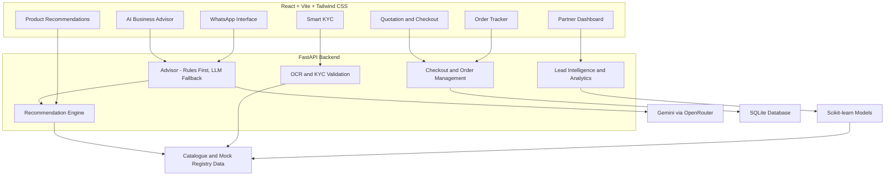

# Udyam OneFlow

**One conversation from "What do you need?" to "You're live" for India's small businesses.**

Built for **Airtel SYNC 2026 · Track A: Project Udyam Digital**

> **Start where you are. Grow when you're ready.**
>
> Udyam OneFlow is an AI-assisted digital onboarding platform that helps MSMEs discover suitable business services, receive personalised bundles, complete document verification, sign up digitally and track activation — all through one unified journey.
>
> It combines an intelligent business advisor, explainable product recommendations, automated KYC, digital checkout, order tracking and partner intelligence.

All data in this project is **synthetic**, including fictional businesses, people and identifiers supplied in the hackathon dataset. "Accel Business" is the fictional brand used by the case.

---

## Contents

- Overview
- Key Features
- Customer Journey
- Architecture
- Technology Stack
- Quick Start
- Demo Walkthrough
- AI and Recommendation Engine
- Smart KYC and Document Verification
- Business Intelligence
- Testing and Results
- API Documentation
- Project Structure
- Privacy and Security
- Assumptions
- Limitations

---

## 1. Overview

Traditional MSME onboarding often involves multiple sales interactions, complicated quotations, physical documentation and repeated follow-ups.

Udyam OneFlow addresses these problems through a unified digital platform.

### The problem

Analysis of the supplied 5,000-lead dataset revealed:

| Metric | Observed baseline |
|---|---:|
| Total leads | 5,000 |
| Contacted leads | 3,406 |
| Needs assessed | 1,974 |
| Quotes accepted | 861 |
| KYC completed | 588 |
| Activated customers | 368 |
| Lead-to-activation conversion | 7.36% |
| Average acquisition cost | ₹15,053 |

### Our approach

- Reduce onboarding friction through conversational AI.
- Recommend eligible products using deterministic business rules.
- Provide transparent pricing and flexible bundles.
- Detect document errors before KYC submission.
- Enable digital checkout and simulated payment authorisation.
- Provide proactive order tracking.
- Help partners identify and prioritise high-potential leads.

---

## 2. Key Features

### A. AI-Powered Business Advisor

An intelligent conversational assistant that understands business requirements and guides customers through onboarding.

Features:
- Conversational business profiling.
- English, Hindi and Tamil support.
- Voice input and quick-reply suggestions.
- Editable business profile.
- GSTIN-based business profile prefill.
- Current internet setup and spending assessment.
- Follow-up questions about products, pricing and eligibility.
- Context-aware recommendations and explanations.
- Human assistance handoff.
- Prompt-injection protection.

The advisor uses rule-based understanding first and calls the LLM when necessary.

### B. Intelligent Product Recommendation

A catalogue-driven recommendation engine that generates personalised business packages.

Three recommendation levels:

| Plan | Purpose |
|---|---|
| Start | Essential business connectivity and services |
| Grow | Expanded digital capabilities |
| Complete | Comprehensive business digital setup |

Features:
- Product eligibility validation.
- Business size and location-based filtering.
- GSTIN and Udyam requirements.
- Product dependency management.
- Contract duration selection.
- Transparent monthly and setup charges.
- Budget-aware recommendations.
- Product unlock paths for currently ineligible customers.

Every recommendation is grounded in the supplied product catalogue.

### C. Dynamic Quotation and Checkout

A transparent quotation and digital checkout experience.

Features:
- Add or remove products.
- Modify product quantities.
- Automatic dependency handling.
- Real-time price recalculation.
- Monthly subscription breakdown.
- One-time installation charges.
- Contract duration selection.
- Aadhaar OTP-based simulated e-sign.
- UPI AutoPay and bank e-NACH simulation.
- Order creation after checkout completion.

### D. Smart KYC and Document Verification

An automated document-verification pipeline designed to reduce onboarding errors.

Supported documents:
- GST registration certificate.
- Udyam registration certificate.
- Address proof.
- Signatory identification.

Capabilities:
- Consent-first document collection.
- Image and PDF upload.
- Local OCR using RapidOCR.
- Field extraction.
- GSTIN checksum validation.
- Mock GSTIN registry verification.
- Mock Udyam registry verification.
- Business name and address matching.
- Document expiry and age checks.
- Document-to-business consistency checks.
- Image quality validation.
- KYC readiness assessment.
- Error explanations and correction hints.
- Document deletion and consent withdrawal.

Additional integration simulations:
- DigiLocker document-fetch experience.
- Aadhaar OTP-based e-sign.

**All government registry lookups and identity-verification integrations are simulated for the prototype.**

### E. Order Tracking

A unified activation tracker that keeps customers informed.

Features:
- Five-stage order progression.
- Expected activation dates.
- Installation scheduling.
- Per-product installation tracking.
- Pending-document notifications.
- Simulated WhatsApp notifications.
- Unified billing information.
- Single customer support contact.
- Help and issue-resolution workflow.

### F. WhatsApp-Style Customer Experience

A dedicated WhatsApp-style conversational interface.

Features:
- Conversational business assistance.
- Context-aware customer interactions.
- Simulated WhatsApp communication.
- Order and onboarding guidance.

### G. Partner Intelligence Dashboard

A dedicated partner cockpit for business intelligence and lead management.

Features:
- Lead funnel analytics.
- Customer segmentation.
- Acquisition source analysis.
- Customer acquisition cost analysis.
- Machine-learning-based lead propensity scoring.
- Next-best-action recommendations.
- Advisor handoff queue.
- Partner referral tracking.
- What-if business impact simulator.
- Model performance metrics.

---

## 3. Customer Journey

The application follows a complete digital onboarding journey:

1. **Discover:** Customer describes their business requirements.
2. **Understand:** AI collects business information and existing spending.
3. **Recommend:** Recommendation engine generates eligible bundles.
4. **Compare:** Customer compares Start, Grow and Complete packages.
5. **Quote:** Customer customises products and receives transparent pricing.
6. **Verify:** Customer uploads documents and completes KYC checks.
7. **Checkout:** Customer completes simulated e-sign and payment authorisation.
8. **Track:** Customer monitors installation and activation progress.

The journey is designed to minimise unnecessary human intervention while preserving assisted support where required.

---

## 4. Architecture



### Technology Stack

| Layer | Technologies |
|---|---|
| Frontend | React 18, TypeScript, Vite |
| Styling | Tailwind CSS |
| Backend | Python, FastAPI, Pydantic |
| Database | SQLite |
| AI integration | Gemini, OpenRouter |
| OCR | RapidOCR, ONNX, OpenCV, Pillow |
| Machine Learning | Scikit-learn |
| Data Processing | Pandas |
| Visualisation | Recharts |
| Testing | Pytest |
| Version Control | Git, GitHub |

---

## 5. Quick Start

### Requirements

- Python 3.11+
- Node.js 18+
- npm
- Git

### Windows (PowerShell)

Clone the repository:

```powershell
git clone https://github.com/vikramhls/airtel.git
```

Navigate to the application:

```powershell
cd airtel/udyam-oneflow
```

Install dependencies:

```powershell
.\run.ps1 setup
```

Start the application:

```powershell
.\run.ps1
```

Open:

```text
http://127.0.0.1:8000
```

### macOS / Linux

```bash
git clone https://github.com/vikramhls/airtel.git

cd airtel/udyam-oneflow

make setup

make serve
```

Application:

```text
http://127.0.0.1:8000
```

### Development Mode

```powershell
.\run.ps1 dev
```

This starts the backend with auto-reload and the Vite development server.

### Run Tests

```powershell
.\run.ps1 test
```

The latest completed test run passed **70 tests**.

---

## 6. Optional AI Configuration

The application supports a rules-based fallback and can operate without an external LLM connection.

To enable external AI providers:

Create your environment file:

```powershell
Copy-Item backend/.env.example backend/.env
```

Configure the following variables:

| Variable | Purpose |
|---|---|
| `GEMINI_API_KEY` | Gemini API authentication |
| `OPENROUTER_API_KEY` | OpenRouter fallback |
| `LLM_PROVIDER` | Provider selection |
| `GEMINI_MODEL` | Gemini model selection |
| `LLM_TIMEOUT_S` | LLM response timeout |

The advisor uses deterministic rules first and falls back to the LLM when required. The current fallback timeout is 8 seconds.

**Never commit API keys or environment files to GitHub.**

---

## 7. Demo Walkthrough

Start the application and follow this customer journey.

### Step 1: Business Discovery

Open the home page and start a new onboarding session.

Example:

"I run a grocery store in Chennai. I have 5 employees and need internet, billing and CCTV."

The advisor collects business details and current setup information.

### Step 2: AI Recommendations

- View the generated business profile.
- Compare Start, Grow and Complete.
- Check product eligibility.
- Explore the explanation behind recommendations.
- Ask follow-up questions about pricing and products.

### Step 3: Quotation

- Add or remove products.
- Change quantities.
- Compare contract durations.
- View the final monthly and installation charges.

### Step 4: KYC Verification

- Provide consent.
- Upload the required documents.
- Use the simulated DigiLocker experience where appropriate.
- Inspect OCR-extracted information.
- Review registry validation.
- Correct flagged fields.

### Step 5: Checkout

- Review the final order.
- Complete the simulated Aadhaar OTP e-sign.
- Use the simulated UPI AutoPay or bank e-NACH option.
- Place the order.

Demo OTP:

```text
123456
```

This is a fixed demonstration OTP, not a real authentication service.

### Step 6: Order Tracking

- Open the order tracker.
- Review activation stages.
- Inspect pending actions.
- View billing information and support details.
- Observe simulated notifications.

### Step 7: Partner Dashboard

Open:

```text
/partner
```

Explore lead scoring, business analytics, partner links and the what-if simulator.

---

## 8. How AI and Automation Work

OneFlow uses AI selectively rather than relying on an LLM for every business decision.

| Function | Technology | Purpose |
|---|---|---|
| Conversation understanding | Rules, regex and LLM fallback | Interpret customer requirements |
| Product recommendation | Deterministic rules engine | Accurate product eligibility |
| Price calculation | Catalogue-based pricing engine | Prevent invented prices |
| Explanation generation | LLM with output validation | Natural-language explanations |
| Document reading | Local RapidOCR | Extract document information |
| Registry validation | Mock CSV registries | Verify synthetic identifiers |
| Lead scoring | Scikit-learn | Prioritise customer leads |
| Order management | FastAPI workflow services | Manage checkout and activation |

### AI Safety

- Product prices are never generated by the LLM.
- Eligibility is validated by deterministic rules.
- LLM-generated explanations are checked against engine outputs.
- Prompt-injection attempts are detected and rejected.
- Sensitive identifiers are masked before text reaches external LLM providers.
- KYC document images are processed locally.

---

## 9. Business Intelligence and Results

The supplied synthetic dataset contains 5,000 business leads.

### Lead Intelligence Model

| Metric | Result |
|---|---:|
| Logistic regression 5-fold ROC-AUC | 0.686 |
| Blended out-of-fold ROC-AUC | 0.691 |
| Monthly revenue model R² | 0.835 |
| Monthly revenue model MAE | ₹4,317 |
| Top-quintile activation | 14.9% |
| Bottom-quintile activation | 1.8% |

The lead model is designed to prioritise potential customers, not make guaranteed predictions.

### What-if Business Projection

The following are simulated projections under editable assumptions, not measured production results.

| Metric | Observed | Projected |
|---|---:|---:|
| Activations | 368 | 670 |
| Lead-to-activation | 7.36% | 13.4% |
| Blended CAC | ₹15,053 | ₹8,622 |

### Automated Testing

**70 tests passed in the latest completed test run.**

Testing covers:

- Advisor conversation scenarios.
- Product eligibility.
- Pricing and bundle dependencies.
- Follow-up questions.
- Multilingual interactions.
- KYC document validation.
- GSTIN and Udyam registry checks.
- Checkout and order workflows.
- Error handling.
- Security and masking behaviour.

---

## 10. API Documentation

The backend exposes REST APIs through FastAPI.

Interactive documentation:

```text
http://127.0.0.1:8000/docs
```

Major API modules include:

| Module | Functionality |
|---|---|
| Session | Customer session and business profile |
| Advisor | Conversational AI and business discovery |
| Catalogue | Product information |
| Recommendation | Product eligibility and bundle generation |
| Quote | Pricing and quotation management |
| Registries | Mock GSTIN and Udyam validation |
| KYC | Consent, upload, OCR and verification |
| Checkout | E-sign and payment workflow simulation |
| Orders | Order placement and tracking |
| Analytics | Business intelligence and funnel analysis |
| Partner | Lead management and partner tracking |

For the complete endpoint list, refer to the interactive FastAPI documentation.

---

## 11. Project Structure

```text
airtel/
│
├── hackathon-pack/
│
└── udyam-oneflow/
    │
    ├── backend/
    │   ├── app/
    │   │   ├── main.py
    │   │   ├── config.py
    │   │   ├── routers/
    │   │   │   ├── advisor.py
    │   │   │   └── checkout.py
    │   │   ├── services/
    │   │   │   ├── advisor.py
    │   │   │   ├── advisor_qa.py
    │   │   │   ├── checkout.py
    │   │   │   ├── llm.py
    │   │   │   └── orders.py
    │   │   └── data/
    │   │
    │   ├── tests/
    │   ├── requirements.txt
    │   └── .env.example
    │
    ├── frontend/
    │   └── src/
    │       ├── api/
    │       ├── components/
    │       ├── i18n/
    │       └── pages/
    │           ├── Home.tsx
    │           ├── Advise.tsx
    │           ├── Plan.tsx
    │           ├── QuotePage.tsx
    │           ├── Kyc.tsx
    │           ├── Checkout.tsx
    │           ├── WhatsApp.tsx
    │           └── Track.tsx
    │
    ├── scripts/
    ├── models/
    ├── reports/
    ├── run.ps1
    ├── Makefile
    └── README.md
```

---

## 12. Privacy and Security

Privacy is considered throughout the onboarding journey.

- **Consent-first collection:** KYC uploads require recorded consent.
- **Data minimisation:** Only information required for validation is collected.
- **Local OCR:** KYC document images are processed locally.
- **Identifier masking:** GSTIN, Udyam, ID and phone numbers are masked in relevant interfaces and logs.
- **Customer control:** Users can correct extracted information and delete documents.
- **Consent withdrawal:** Customers can withdraw consent.
- **Auditability:** Consent, document and order-related activities are recorded.
- **Mock registries:** No actual government registry integration is performed.
- **Credential protection:** API keys are stored in ignored environment files.

The prototype assigns a seven-day document deletion period, but automatic expiry-based purge is not yet implemented.

---

## 13. Assumptions and Limitations

### Assumptions

- All business and customer data is synthetic.
- Pricing follows the supplied catalogue and configured pricing rules.
- The reference date for document validation is 15 July 2026.
- Contract durations affect catalogue-based price selection.
- Activation ETAs are calculated using configured workflow rules.

### Limitations

- GSTIN and Udyam verification use mock registries.
- DigiLocker and Aadhaar OTP e-sign are simulated.
- UPI AutoPay and bank e-NACH are simulated.
- WhatsApp communication is a prototype simulation.
- OCR is tuned to the supplied specimen document layouts.
- The lead propensity model has modest predictive performance and should be treated as a prioritisation tool.
- Production deployment would require real telecom, payment, identity and government integrations, along with appropriate security and compliance reviews.

---

## 14. Future Scope

Potential production enhancements include:

- Live Airtel product catalogue integration.
- Real GSTIN and Udyam verification APIs.
- Production DigiLocker integration.
- Actual Aadhaar e-sign integration through authorised providers.
- Real UPI AutoPay and e-NACH integration.
- WhatsApp Business API integration.
- Real-time network availability checks.
- Regional-language expansion.
- Advanced partner CRM and lead management.
- Production monitoring and analytics.

---

## Project Information

**Project:** Udyam OneFlow  
**Challenge:** Airtel SYNC 2026  
**Track:** Track A – Project Udyam Digital  
**Repository:** https://github.com/vikramhls/airtel  
**Application:** React + FastAPI  
**Primary objective:** Simplifying MSME digital onboarding through intelligent recommendations, automated verification and unified activation tracking.

---

*Built for Airtel SYNC 2026 · Track A: Project Udyam Digital.*

**Udyam OneFlow — From business needs to digital activation, in one flow.**
